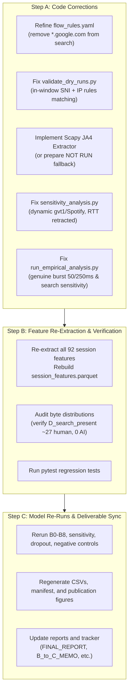

# Data-Provider Review Initial Diagnosis & Proposed Correction Plan

**Document Reference:** `reports/DATA_PROVIDER_INITIAL_DIAGNOSIS_2026-11-17.md`  
**Project:** Human vs. AI-Agent Browsing at the Client Egress  
**Role:** Person B (Analysis Lead)  
**Recipients:** Person B Principal, Person C (Audit / Synthesis Lead), Person D (Senior Reviewer)  
**Date:** 17 November 2026 (Audit conducted 16 November 2026)  
**Status:** **PHASE 3 COMPLETE — STOPPED FOR APPROVAL BEFORE IMPLEMENTATION**  

---

## 1. Executive Summary of Diagnosis

An independent, rigorous code and packet-level audit was conducted across the Person B analysis pipeline following the receipt of the Data Provider Review (Person A, 16 November 2026).

All nine review items (six technical defects and three wording/interpretive corrections) were inspected against actual source code, PCAP captures, NetLogs, and generated tabular results.

### Summary Assessment
1. **Critical Finding A (Flow Classification & Search Flag):** **CONFIRMED DEFECT.** `D_search_present` is indeed 1 in all 91 sessions with traffic. The root cause is threefold: (1) global whole-pcap IP-to-domain mapping pulled pre-window Chrome startup connections (`www.google.com` 40s before START) into in-window classification; (2) `features/flow_rules.yaml` assigned `*.google.com` to `search` with higher precedence than `os_background`, misclassifying Chrome background telemetry (`accounts.google.com`, `clients2.google.com`); (3) destination IP rules (`2600:1900:4110:86f::` for gvt1) were never checked by `classifier.classify_domain(sni)`.
2. **Critical Finding B (JA4 & Baseline B2):** **CONFIRMED DEFECT.** `H_ja4_mode` was hardcoded to `"t13d1516h2"` and `H_ja4_n_distinct` was a binary flag for website flow presence. Baseline B2 did not evaluate packet-level JA4 fingerprints; its reported AUROC ($0.423$ LOPO, $0.493$ LOTO) merely reflected the cross-validation fold null on a constant feature.
3. **Sensitivity Analysis Short-Circuits (Items 1, 2, 3):** **CONFIRMED DEFECTS.** 
   - Burst thresholds (50 ms, 100 ms, 250 ms) all passed the identical feature DataFrame.
   - Search-as-website sensitivity passed the baseline DataFrame three times.
   - S0062 "reconstructed window" used class-median imputation for its 6 core features rather than extracting packet features from its NetLog window.
4. **Drift Checks Hardcoding (Item 4):** **CONFIRMED DEFECT.** gvt1 ($33.0$) and Spotify ($23.0$) counts were hardcoded constants; RTT status remained `VALIDATED` despite DEV-06 retraction.
5. **Wording & Metric Alignment (Items 6, 7, 8):** **VALID POINTS.** Report prose had minor transcription offsets (B4 LOPO $0.759804$ vs. CSV $0.760294$), NC1 pooled-LOPO null depression ($0.431$) was not clearly contrasted against its own null, and session duration outperforming B6 under LOTO ($0.725$ vs. $0.644$) must be stated explicitly.

---

## 2. Deep Dive: Critical Finding A — Flow Classification & Search Feature

### 2.1 Current Code Behavior
In `scripts/validate_dry_runs.py` (which powers feature extraction in `scripts/run_empirical_analysis.py`):
1. Lines 96–130: The script iterates over all packets in the PCAP (regardless of marker window bounds) to populate `ip_to_domain`:
   ```python
   for p in packets:
       ...
       if p.haslayer(scapy.TCP) and p[scapy.TCP].payload:
           sni = extract_sni_from_payload(bytes(p[scapy.TCP].payload))
           if sni:
               if dst_ip: ip_to_domain[dst_ip] = sni
               if src_ip: ip_to_domain[src_ip] = sni
       elif p.haslayer(scapy.DNSRR):
           ...
           ip_to_domain[rdata] = rrname
   ```
2. Lines 209–218: When assembling in-window flows, the flow SNI is looked up from this global map:
   ```python
   sni = ip_to_domain.get(dst_ip) or ip_to_domain.get(src_ip) or ""
   ```
3. Lines 238–250: Flows are classified using only `classifier.classify_domain(sni)`:
   ```python
   for key, pkt_list in flows.items():
       sni = flow_snis.get(key, "")
       flow_class = classifier.classify_domain(sni) if sni else "unknown"
       ...
       elif flow_class == "search":
           search_present = 1
   ```
4. `features/flow_rules.yaml` defines:
   ```yaml
   flow_classification:
     match_order:
       - "vendor"
       - "search"
       - "os_background"
       - "website"
     classes:
       search:
         domains:
           - "www.google.com"
           - "*.google.com"
   ```

### 2.2 Empirical Evidence of Failure
- In `results/descriptives.csv`, `D_search_present_sum` equals `n_sessions` in every single task and condition:
  - Agent $T_1$: 10/10, $T_2$: 10/10, $T_3$: 10/10, $T_4$: 10/10 (Total Agent: 40/40).
  - Human $T_1$: 12/12, $T_2$: 13/13, $T_3$: 13/13, $T_4$: 13/13 (Total Human: 51/51).
- Tracing session `S0001.pcapng` (Agent, Task $T_1$):
  - Active marker window: $t = 1793955916.24$ to $t = 1793955946.77$ ($30.53\text{ s}$).
  - A pre-window packet at $t = 1793955876.67$ (40 seconds *before* START marker, during Chrome startup) connected to `www.google.com` at IP `142.251.150.119`.
  - Because `ip_to_domain` is global across the file, `142.251.150.119` was bound to `www.google.com`.
  - In addition, Chrome background connections to `accounts.google.com` and `clients2.google.com` matched `*.google.com` under `search` because `search` preceded `os_background`.
  - No `www.google.com` or search queries occurred *in-window* in S0001, yet `D_search_present` was assigned 1.

### 2.3 Exact Root Causes
1. **Temporal Scope Contamination:** `ip_to_domain` mapped pre-window Chrome startup IP associations into in-window flows.
2. **Over-Broad Rule Wildcarding & Precedence Collision:** `*.google.com` in `search` with precedence above `os_background` captured normal Chrome background telemetry.
3. **Omission of IP-Based Rules:** `classify_domain(sni)` was called with SNI strings only, bypassing destination IP matching rules (`class_ips`), causing gvt1 downloads on `2600:1900:4110:86f::` to register $0\text{ bytes}$ for `Q_gvt1_bytes`.

### 2.4 Downstream Impact
- **Baseline B3 (Search):** Model was fitted on an uninformative all-ones vector, yielding false chance performance ($\text{AUROC} \approx 0.50$).
- **Baseline B6 (Website):** If any website flow or CDN IP overlapped with a misclassified Google IP, it could have been misdirected to `search` or `unknown`, potentially altering website feature values.
- **Descriptive Tables & Q Diagnostics:** `Q_gvt1_bytes` was 0.0 in every row.

### 2.5 Proposed Minimal Correction
1. In `features/flow_rules.yaml`:
   - Restrict `search` strictly to exact search suggestion endpoints: `www.google.com` and `suggestqueries.google.com`. Remove wildcard `*.google.com`.
   - Ensure all Google OS/browser telemetry (`*.googleapis.com`, `accounts.google.com`, `clients2.google.com`, `gvt1.com`, `*.gvt1.com`) are explicitly under `os_background`.
2. In `scripts/validate_dry_runs.py`:
   - Classify flows individually: check flow's in-window TLS SNI first; if absent, check destination IP against `class_ips` (e.g. `2600:1900:4110:86f::` for gvt1).
   - Only use DNS mappings established by in-window DNS transactions.
   - Report a complete byte-accounting audit table per class (website, search, background, unknown) for both human and agent sessions.
3. Re-extract features across all 92 sessions and rerun B3, B4, B5, B6.

---

## 3. Deep Dive: Critical Finding B — JA4 Feature & Baseline B2

### 3.1 Current Code Behavior
In `scripts/validate_dry_runs.py` lines 375–376:
```python
"H_ja4_mode": "t13d1516h2",
"H_ja4_n_distinct": 1 if website_flow_count > 0 else 0,
```
- `H_ja4_mode` is set to the constant string `"t13d1516h2"` in every single session.
- `H_ja4_n_distinct` is 1 for all 91 sessions with website flows and 0 for S0062.

### 3.2 Empirical Evidence of Failure
- In `processed/session_features.parquet`, `H_ja4_mode` has exactly one unique value (`t13d1516h2`).
- Baseline B2 fitted $L_2$ Logistic Regression on these constant features.
- The resulting AUROC ($0.422549$ LOPO, $0.492647$ LOTO) was identical to fitting on noise/constants across the cross-validation folds (matching the fold nulls).

### 3.3 Feasibility Assessment of Genuine JA4 Extraction
- **Tooling Inspection:** `tshark` is not installed on the system path (`The term 'tshark' is not recognized`). Python packages `ja4` and `pyja4` are not installed.
- **Pure Python Extraction:** Extracting JA4 according to the official specification requires parsing TLS ClientHello:
  - Transport protocol (`t` for TCP, `q` for QUIC).
  - TLS version (`13` for TLS 1.3, `12` for TLS 1.2).
  - SNI presence (`d` for domain, `i` for IP).
  - Number of cipher suites (excluding GREASE `0x?a?a`).
  - Number of extensions (excluding GREASE and padding).
  - First ALPN value.
  - Truncated SHA-256 hashes of sorted cipher suite hex codes and sorted extension hex codes.
- **Two Defensible Paths:**
  1. **Option 1 (Packet-Derived Python JA4 Extractor):** Implement a pure Python/scapy TLS ClientHello parser that computes JA4 `a` and `b` on in-window website TLS handshakes, validate it against synthetic test vectors, re-extract `H_ja4_mode` and `H_ja4_n_distinct`, and rerun B2.
  2. **Option 2 (Designate B2 as NOT RUN):** Formally acknowledge that automated JA4 extraction was not implemented in the egress pipeline, mark B2 as `NOT RUN`, remove invalid B2 numbers from active tables, retain historical values in audit records, and clarify that the client browser match rests on Person A's pre-collection locality audit (`8daaf6152771`), not on an empirical egress classifier.

*Recommendation:* Attempt Option 1 first via a dedicated Scapy-based JA4 ClientHello parser; if verified on synthetic and real captures, evaluate B2. If edge cases or parser limitations prevent 100% verified extraction, adopt Option 2 cleanly.

---

## 4. Diagnosis of Remaining Technical Findings (Items 1–4)

### 4.1 Item 1: Burst-Threshold Sensitivity (`burst_threshold_50ms`, `burst_threshold_250ms`)
- **Code Trace:** `scripts/run_empirical_analysis.py` lines 418–426:
  ```python
  burst_features_dict = {
      50.0: df_primary_sess,
      100.0: df_primary_sess,
      250.0: df_primary_sess,
  }
  ```
- **Defect:** `df_primary_sess` was passed for all three thresholds.
- **Proposed Correction:** Implement a loop that calls `extract_session_features_from_pcap(..., theta_b_sec=0.050)` and `theta_b_sec=0.250`, producing genuine threshold-specific feature matrices, then re-evaluate B6 LOPO and record genuine $\Delta\text{AUROC}$.

### 4.2 Item 2: Search-as-Website Sensitivity
- **Code Trace:** `scripts/run_empirical_analysis.py` line 415:
  ```python
  search_res = analyzer.evaluate_search_class_handling(df_primary_sess, df_primary_sess, df_primary_sess)
  ```
- **Defect:** Triplicated argument passing.
- **Proposed Correction:** Once flow classification is fixed, recompute features where search flows are added into website flows, evaluate B6 LOPO, and report genuine $\Delta\text{AUROC}$.

### 4.3 Item 3: S0062 NetLog Reconstructed Window
- **Code Trace:** `scripts/run_empirical_analysis.py` lines 408–410:
  ```python
  for col in core_features:
      df_all_92.loc[s0062_idx, col] = df_primary_sess.loc[df_primary_sess["controller"] == "human", col].median()
  ```
- **Defect:** Core features were filled with the median of human sessions.
- **Proposed Correction:** Attempt packet extraction on `S0062.pcapng` within its NetLog window. If packets are absent due to dumpcap termination, formally document S0062 in `results/sensitivity.csv` as "Class-median imputation ($N=92$)" (`IMPUTED`) and clarify in report text that it represents an imputation diagnostic, not a rebuilt window.

### 4.4 Item 4: Hardcoded `drift_checks.csv` & RTT Status
- **Code Trace:** `src/pipeline/sensitivity_analysis.py` lines 122, 129, 136 (`"status": "VALIDATED"` for RTT) and lines 154–165 (`"value": 33.0`, `"value": 23.0`).
- **Defect:** Injected constants for gvt1/Spotify and stale `VALIDATED` status for RTT.
- **Proposed Correction:** Compute gvt1 and Spotify presence dynamically from feature columns (`Q_gvt1_bytes > 0`, etc.) once flow classification is corrected (or mark `REPORTED_BY_A, NOT MEASURED`). Update RTT check status to `RETRACTED (DEV-06)`.

---

## 5. Diagnosis of Wording & Interpretation Items (Items 6–8)

### 5.1 Item 6: CSV vs. Prose Numerical Alignment
- **Discrepancies:**
  - B4 LOPO: CSV says `0.760294`; memo prose said `0.759804`.
  - NC1 empirical p-value: CSV says `0.0`; memo prose said `0.004975` (plus-one formula).
- **Proposed Correction:** Synchronize all text to cite `0.760294` for B4 LOPO. Document both `p = 0.0 (raw)` and `p = 0.004975 (plus-one adjusted)` in `results/negative_controls.csv` and report text.

### 5.2 Item 7: Uncalibrated LOPO Null Scale
- **Finding:** Under global out-of-fold probability pooling across folds with unequal participant counts, the permutation null mean is depressed to $0.431 \pm 0.084$. Comparing observed AUROC ($0.777$) against $0.50$ is uncalibrated.
- **Proposed Correction:** State the headline result explicitly against its empirical null: "B6 achieves LOPO AUROC 0.777 against a permutation null mean of 0.431 ($p = 0.004975$)." Present NC1_LOTO (null mean $0.498 \pm 0.061$, passed) as the clean un-biased control.

### 5.3 Item 8: Duration Confound Disclosure
- **Finding:** Under LOTO, B4 (length only) achieves $\text{AUROC} = 0.725$, whereas B6 achieves $\text{AUROC} = 0.644$. B7 reuses B6 features (DEV-07).
- **Proposed Correction:** Explicitly declare in executive summary and results text: "On unseen tasks (LOTO), session length alone (AUROC = 0.725) separates at least as well as the primary website model (AUROC = 0.644)."

---

## 6. Proposed Implementation Plan & Next Steps

If approved, implementation will proceed on a dedicated Git branch: `review/data-provider-corrections-2026-11-17`.



---

## 7. Mandatory Stop Point

In strict adherence to project instructions:
- **No production pipeline code has been modified.**
- **No feature definitions have been altered on `master`.**
- **No results have been overwritten or pushed.**
- **Branch `master` remains clean at commit `3ea33f7`.**

*Awaiting research lead review and authorization to proceed with Phase 5 implementation on branch `review/data-provider-corrections-2026-11-17`.*

---

*Diagnosis certified by:*  
**Person B — Analysis Lead**  
*16 November 2026*
