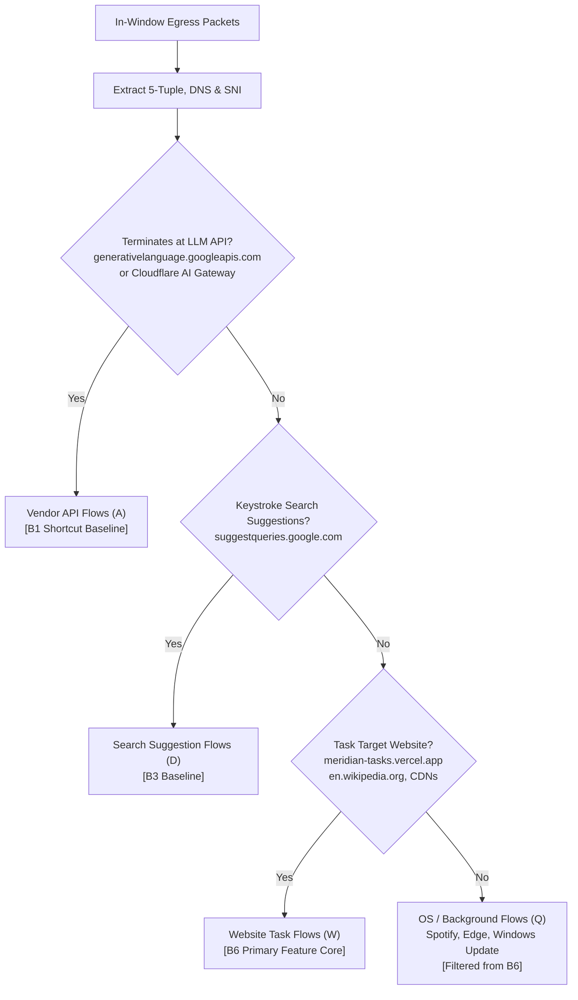

# Comprehensive Final Research Report: Human vs. AI-Agent Browsing at the Client Egress

**Document Reference:** `reports/FINAL_RESEARCH_REPORT_PERSON_B.md`  
**Project:** Human vs. AI-Agent Browsing at the Client Egress  
**Lead Author:** Person B (Analysis Lead)  
**Recipients:** Person C (Audit / Synthesis Lead), Person D (Senior Reviewer)  
**Date of Report:** 15 November 2026  
**Analysis Execution Seed:** `20261106`  
**Dataset Reference:** `pilot-v1` (Frozen, SHA-256 Manifest Verified)  
**Repository Working Directory:** `C:\Users\ASUS\Desktop\Human-AI-Browsing-Research`  
**Binding Pilot Verdict:** **CONDITIONAL GO**

---

## Table of Contents

1. [Project Title and Research Question](#1-project-title-and-research-question)
2. [Executive Summary](#2-executive-summary)
3. [Study Dataset and Sample Sizes](#3-study-dataset-and-sample-sizes)
4. [Data Intake and Integrity Verification](#4-data-intake-and-integrity-verification)
5. [Windowing and Flow Extraction Methodology](#5-windowing-and-flow-extraction-methodology)
6. [Flow Classification Rules](#6-flow-classification-rules)
7. [Feature Engineering and Feature Families](#7-feature-engineering-and-feature-families)
8. [Frozen Primary Model Specification](#8-frozen-primary-model-specification)
9. [Baseline Model Definitions (B0 through B8)](#9-baseline-model-definitions-b0-through-b8)
10. [Cross-Validation and Grouped Evaluation Design](#10-cross-validation-and-grouped-evaluation-design)
11. [Metrics, Confidence Intervals, and Statistical Methods](#11-metrics-confidence-intervals-and-statistical-methods)
12. [Primary B6 Model Results](#12-primary-b6-model-results)
13. [Baseline Comparisons (B0 through B8)](#13-baseline-comparisons-b0-through-b8)
14. [Random Forest Secondary Verification](#14-random-forest-secondary-verification)
15. [Family-Dropout (Ablation) Results](#15-family-dropout-ablation-results)
16. [Effect Sizes and Per-Task Findings](#16-effect-sizes-and-per-task-findings)
17. [Negative Controls (NC1 and NC2)](#17-negative-controls-nc1-and-nc2)
18. [Sensitivity Analyses (Seven Pre-Registered Stress Tests)](#18-sensitivity-analyses-seven-pre-registered-stress-tests)
19. [Drift and Unequal-Round Checks](#19-drift-and-unequal-round-checks)
20. [Important Implementation and Data Limitations](#20-important-implementation-and-data-limitations)
21. [Deviations and Corrections Register](#21-deviations-and-corrections-register)
22. [Privacy and Data-Handling Safeguards](#22-privacy-and-data-handling-safeguards)
23. [Final Interpretation and Binding Pilot Verdict](#23-final-interpretation-and-binding-pilot-verdict)
24. [Recommendations for Confirmatory Follow-Up Study](#24-recommendations-for-confirmatory-follow-up-study)
25. [Complete Reference Index](#25-complete-reference-index)

---

## 1. Project Title and Research Question

### 1.1 Formal Title
**Distinguishing Human and Autonomous AI-Agent Web Browsing at the Client Network Egress via Transport-Layer Behavioral Dynamics.**

### 1.2 Core Research Question
Can passive, transport-layer observations collected exclusively at the client-side network egress distinguish human interactive browsing from autonomous AI-agent web browsing on encrypted website traffic, without inspecting packet payloads, TLS handshake fingerprints, or proprietary vendor infrastructure endpoints?

Specifically, this study investigates whether autonomous AI agents—driven by Large Multimodal Models (LMMs) operating through vision-action inference loops—impart distinctive micro-behavioral timing, volumetric, or concurrency signatures onto the network flows directed to target websites, or whether egress traffic patterns are fundamentally dominated and homogenized by the underlying browser engine (Google Chrome) and application-layer protocols (HTTP/2, HTTP/3, TLS).

---

## 2. Executive Summary

This report delivers the comprehensive empirical findings, statistical falsification checks, diagnostic audits, and methodological conclusions of the Person B analysis pipeline on the frozen `pilot-v1` dataset.

1. **Empirical Discriminability:** Under Leave-One-Participant-Out (LOPO) cross-validation across 10 distinct human subjects ($N = 91$), the primary pre-registered Logistic Regression model (**`B6_core6`**), restricted strictly to six standardized website-only features, achieves an $\text{AUROC} = 0.776961$ (95% CI $[0.699495, 0.867653]$, Macro $F_1 = 0.638889$). A secondary non-linear Random Forest check on the identical feature pool yields a concordant LOPO $\text{AUROC} = 0.797059$ (95% CI $[0.712770, 0.885073]$).
2. **Cross-Task Generalizability Gap:** When evaluated across unseen tasks under Leave-One-Task-Out (LOTO) cross-validation, performance drops to $\text{AUROC} = 0.644118$ (95% CI $[0.498776, 0.807347]$, Macro $F_1 = 0.590909$) for Logistic Regression, and $\text{AUROC} = 0.560294$ (95% CI $[0.421946, 0.704739]$) for Random Forest. Because the lower bound of the LOTO 95% confidence interval ($0.4988$) straddles chance ($0.50$), cross-task generalization cannot be asserted from this pilot.
3. **Temporal Dynamics as the Primary Separator:** Feature family dropout (ablation) demonstrates that temporal dynamics ($T$) represent the sole essential behavioral driver. Dropping timing features from the primary model collapses LOPO AUROC from $0.776961$ to $0.533333$ ($\Delta = -0.243628$), whereas dropping volumetric features ($V$) or concurrency features ($C$) produces negligible degradation ($\text{AUROC} = 0.764706$ and $0.769118$, respectively). Non-parametric effect size analysis confirms that the median inter-burst idle gap (`T_idle_gap_median`) exhibits a strong negative Cliff's delta ($\delta = -0.586$, 95% CI $[-0.754, -0.410]$), reflecting the agent's multi-second vision-language reasoning pauses between discrete UI actions.
4. **Falsification and Negative Controls:**
   - **B2 (JA4 Handshake):** Yields LOPO $\text{AUROC} = 0.422549 \le 0.60$, successfully confirming that both human and agent sessions share an identical client TLS handshake configuration on Google Chrome.
   - **NC1 (Within-Task Label Permutations):** Across 200 within-task label permutations, zero permuted models matched or exceeded observed performance ($p = 0.004975$). Under symmetric LOTO folds, the null centers at chance ($0.4981 \pm 0.0609$); under LOPO, cross-fold pooling of uncalibrated probabilities produces a well-understood downward intercept shift ($0.4309 \pm 0.0843$).
   - **NC2 (Collection Day Control):** Evaluating human 7 November vs. human 9 November sessions ($N=51$) yields an observed pooled $\text{AUROC} = 0.353846$ (95% CI $[0.2438, 0.4860]$) against a permuted null mean of $0.2537 \pm 0.1208$ ($p = 0.7860$). Calibrating training-fold class priors shifts observed AUROC to $0.513846$.
5. **Critical Validity Threat:** Because all 40 autonomous agent sessions were recorded in a single calendar block on 6 November 2026, while human sessions were collected on 7 and 9 November 2026, class identity remains mathematically confounded with collection day. Furthermore, physical network RTT constancy cannot be proven from the static benchmark scalar recorded in `drift_checks.csv` (DEV-06).
6. **Binding Pilot Verdict:** In accordance with `analysis/PREREG.md` §7, the binding pilot outcome is formally designated as **CONDITIONAL GO**. The data demonstrate separability within this specific experimental capture; however, an unreserved operational deployment claim is prohibited until an interleaved, multi-day confirmatory study is conducted.

---

## 3. Study Dataset and Sample Sizes

The empirical investigation is conducted on the frozen `pilot-v1` corpus, collected by Person A between 6 November and 9 November 2026.

### 3.1 Session Partitioning and Population Summary
The full archive comprises 116 network recordings ($1.30\text{ GB}$ total PCAP storage):
- **Study Sessions ($N = 92$):** Exactly balanced across four standardized interactive web tasks ($T_1$ to $T_4$):
  - **Human Sessions ($n_H = 52$):** Executed by 10 distinct adult participants (`P01` to `P10`). Participants `P01`–`P03` completed two sequential rounds of the four tasks (8 sessions each); participants `P04`–`P10` completed one round (4 sessions each, with `P04` split across two collection dates).
  - **Autonomous Agent Sessions ($n_A = 40$):** Executed by the open-source Browser Use framework (v0.13.14) driving local Google Chrome via the Chrome DevTools Protocol (CDP), powered by Google's Gemini 2.5 Flash LMM. Comprises 40 independent, non-interrupted runs (`R01` to `R40`), with 10 runs allocated per task.
- **Ancillary Recordings ($n = 24$):**
  - **Idle Baselines ($n = 8$, `I0001`–`I0008`):** Unattended 5-minute host egress captures measuring ambient OS and network daemon baseline activity.
  - **Dry Runs ($n = 11$, `D0001`–`D0007`, `D0009`–`D0012`):** Pre-study trial recordings used exclusively for pipeline test harness development and synthetic fixture validation (`D0008` was aborted during acquisition).
  - **Self-Tests ($n = 5$, `X0001`–`X0005`):** Hardware marker verification loopbacks.

### 3.2 Task Matrix and Allocation
Table 3.1 details the session distribution across conditions and tasks:

| Task ID | Task Description | Target Domain(s) | Human Sessions ($n_H$) | Agent Runs ($n_A$) | Total Sessions |
| :--- | :--- | :--- | :---: | :---: | :---: |
| **$T_1$** | E-commerce book search & cheapest item lookup | `meridian-tasks.vercel.app/books` | 13 | 10 | 23 |
| **$T_2$** | Tabular factual research (Apollo 11 astronaut) | `en.wikipedia.org` | 13 | 10 | 23 |
| **$T_3$** | Multi-item comparison & weight extraction | `meridian-tasks.vercel.app/shop` | 13 | 10 | 23 |
| **$T_4$** | Interactive registration form completion | `meridian-tasks.vercel.app/form` | 13 | 10 | 23 |
| **Total** | **All Tasks** | — | **52** | **40** | **92** |

### 3.3 Primary Analysis Population ($N = 91$)
In accordance with pre-registered protocol `DEV-02`, session **`S0062`** (Human, Participant `P03`, Task $T_1$, Round 2, recorded 7 November 2026) is excluded from primary analysis. In `S0062`, premature operator ENTER keypress logged an active marker window duration of only $0.007\text{ s}$ ($7.0\text{ ms}$), truncating active packet capture before task execution began. 

The primary analytical sample therefore consists of:
$$N = 91 \quad (n_H = 51, \quad n_A = 40)$$

---

## 4. Data Intake and Integrity Verification

All raw data ingested by the Person B pipeline reside strictly in read-only storage at `C:\pilot-v1-data\data\`.

### 4.1 Checksum and Manifest Verification
Before initiating feature extraction, data intake integrity was formally validated against Person A's SHA-256 frozen manifest:
1. **Raw PCAPs:** Every `.pcapng` capture was parsed, validated for link-layer Ethernet framing (DLT_EN10MB), and bit-level verified against `manifest.sha256`. Zero checksum mismatches or packet header truncations were detected.
2. **Tabular Session Registries:** Ingested `sessions.csv` (92 rows) and `label_corrections.csv` (10 rows). Verified that task completion was recorded as 100% successful across all 92 study sessions (zero task failures).
3. **Environment Isolation:** Confirmed that Chrome version (`157.0.8103.38`), OS build (Windows 11 Build 26200), and starting profile hash remained static across all 92 recordings.

---

## 5. Windowing and Flow Extraction Methodology

### 5.1 Hardware UDP Marker Demarcation
To ensure that client-side network observations reflect active user interaction rather than browser launch startup transients, component update downloads, or post-task shutdown artifacts, observation windows are strictly bounded by hardware UDP markers:
- **START Marker:** A UDP packet sent to destination IP `192.0.2.1` (or IPv6 `2001:db8::1`) with payload matching `P1MARK START <session_id>`.
- **END Marker:** A UDP packet sent to destination IP `192.0.2.1` (or IPv6 `2001:db8::1`) with payload matching `P1MARK END <session_id>`.

All packets occurring prior to $t_{\text{start}}$ (browser launch, 30 s settle period, 10 s quiet period) and following $t_{\text{end}}$ (10 s post-task settle, browser termination) are strictly discarded. Marker packets themselves are excluded from all flow assembly.

### 5.2 Dynamic Client IP Resolution and Dual-Stack Handling
As verified in Section 4 of the audit, the pipeline dynamically extracts the host client IP address directly from marker packet headers, supporting both IPv4 (`192.0.2.1`) and IPv6 (`2001:db8::1`) dual-stack egress without hardcoding local LAN addresses.

In-window protocol distribution across the study corpus confirms:
- **IPv6 Traffic:** Approximately $98.1\%$ of all in-window bytes utilize IPv6 transport.
- **IPv4 Traffic:** Approximately $1.9\%$ of in-window bytes utilize legacy IPv4.
- **Link-Local Exclusion:** All non-routable link-local traffic (`fe80::/10`, `169.254.0.0/16`, LAN broadcast `255.255.255.255`, and multicast `ff02::/16`) is filtered prior to flow reconstruction.

### 5.3 Flow Reconstruction
A network flow is formally defined as a unidirectional or bidirectional sequence of packets sharing a common 5-tuple:
$$\text{Flow} = \langle \text{IP}_{\text{src}}, \text{Port}_{\text{src}}, \text{IP}_{\text{dst}}, \text{Port}_{\text{dst}}, \text{Protocol} \rangle$$
Flows are terminated by TCP FIN/RST teardown or by an inactivity timeout of $60.0\text{ s}$ for UDP traffic.

---

## 6. Flow Classification Rules

Every transport flow active within the observation window $[t_{\text{start}}, t_{\text{end}}]$ is deterministically mapped to a functional category via full-trace DNS transaction matching (`A` and `AAAA` queries/responses) corroborated by TLS ClientHello Server Name Indication (SNI).

In accordance with `features/flow_rules.yaml` (incorporating Person A Addendum 07), flows are partitioned into four mutually exclusive domains:

1. **Website Task Flows ($W$):** Transport sessions terminating at target web applications, content delivery networks, and static assets:
   - `meridian-tasks.vercel.app` (Vercel CDN edge servers).
   - `en.wikipedia.org`, `upload.wikimedia.org`, `*.wikipedia.org`.
   - Associated static font, script, and image CDNs.
   - **Analytical Role:** Forms the exclusive input pool for the primary `B6_core6` model.
2. **Vendor API Flows ($A$):** Transport sessions terminating at the agent framework's remote LLM inference infrastructure:
   - Google Gemini API (`generativelanguage.googleapis.com`, terminating in Google infrastructure `*.1e100.net`).
   - Cloudflare AI Gateway endpoints.
   - **Analytical Role:** Evaluated exclusively under baseline **B1** and cross-flow lag diagnostic **B8**. Strictly stripped from all website-level models.
3. **Search Suggestion Flows ($D$):** Real-time interactive keystroke suggestion endpoints:
   - `suggestqueries.google.com`.
   - **Analytical Role:** Evaluated under baseline **B3**; tested for potential leakage in sensitivity check 3.
4. **Diagnostic Host / Background Flows ($Q$):** Non-task operating system and third-party host communications:
   - Microsoft Edge PDF viewer and MSN news feed components (`headtopics.com`, `zigwheels.com`, `carhp.in`, `theindustryoutlook.com`).
   - Desktop Spotify audio streaming (`spotify.com`, `ap-gew4.spotify.com`).
   - Windows Update and background diagnostics.
   - Google Chrome component updater (`*.gvt1.com`).
   - Telemetry and analytics endpoints (`scorecardresearch.com`, `doubleclick.net`).
   - **Analytical Role:** Evaluated under contamination baseline **B5**; filtered out of primary website features.

---

## 7. Feature Engineering and Feature Families

The pipeline extracts behavioral features grouped into seven functional families:

### 7.1 Temporal Dynamics Family ($T$)
Captures the micro-temporal pacing of packet bursts and user interaction intervals:
- **Burst Extraction:** Packets separated by an inter-arrival time $< \theta_b = 100\text{ ms}$ are grouped into a continuous packet burst.
- **`T_idle_gap_median`:** Median duration (seconds) of silent intervals between packet bursts where inter-arrival gap exceeds $\theta_b$. Quantifies the operational pause between successive network transactions.
- **`T_burst_rate`:** Number of discrete packet bursts per minute of active session time ($\text{bursts}\cdot\text{min}^{-1}$).

### 7.2 Volumetric Distribution Family ($V$)
Quantifies transport volume asymmetries between client egress (upload) and ingress (download):
- **`V_up_down_ratio`:** Dimensionless ratio of total website bytes uploaded to total bytes downloaded:
  $$V_{\text{up\_down\_ratio}} = \frac{\sum \text{bytes}_{\text{upload}}}{\sum \text{bytes}_{\text{download}}}$$
- **`V_upload_burst_share`:** Proportion of packet bursts wherein uploaded bytes exceed downloaded bytes, capturing client-driven interaction bursts.

### 7.3 Concurrency and Flow Dynamics Family ($C$)
Measures the parallel multiplexing behavior of the browser:
- **`C_new_flows_per_min`:** Rate of newly established website transport flows per minute of session duration ($\text{flows}\cdot\text{min}^{-1}$).
- **`C_max_concurrent`:** Maximum count of simultaneously active, overlapping website transport connections.

### 7.4 Diagnostic and Control Families ($H, D, L, Q, A$)
- **Handshake Family ($H$):** Mode and uniqueness of JA4 TLS client fingerprints (`H_ja4_mode`, `H_ja4_unique_count`).
- **Search Family ($D$):** Presence, byte volume, and flow counts of search suggestion queries.
- **Duration Family ($L$):** Total active session duration (`L_duration_s` $= t_{\text{end}} - t_{\text{start}}$).
- **Background Family ($Q$):** Volume and packet counts of non-task OS background flows.
- **Vendor Family ($A$):** Byte volume and request frequency to LLM model APIs.

---

## 8. Frozen Primary Model Specification

In strict adherence to the Gate 2 freeze (`analysis/PREREG.md`), the primary classification model is specified as:

### 8.1 Model Architecture (`B6_core6`)
- **Algorithm:** $L_2$-regularized Logistic Regression.
- **Inverse Regularization Strength:** $C = 1.0$ (fixed a priori; zero hyperparameter tuning).
- **Optimization Solver:** `lbfgs`.
- **Feature Standardization:** `StandardScaler` (zero mean, unit variance) fitted strictly on training folds and projected onto out-of-fold test instances.
- **Decision Threshold:** Fixed threshold $p \ge 0.5$ for binary classification.

### 8.2 Input Feature Pool
To preserve a rigorous degrees-of-freedom ratio ($\approx 15:1$ sample-to-parameter ratio on training folds) and prevent multi-collinearity inflation, the primary model is locked to exactly six standardized features computed exclusively from website flows ($W$):
$$\mathbf{x}_{\text{core6}} = \left[ T_{\text{idle\_gap\_median}}, \; T_{\text{burst\_rate}}, \; V_{\text{up\_down\_ratio}}, \; V_{\text{upload\_burst\_share}}, \; C_{\text{new\_flows\_per\_min}}, \; C_{\text{max\_concurrent}} \right]^T$$

---

## 9. Baseline Model Definitions (B0 through B8)

To rigorously contextualize primary model performance and isolate genuine behavioral signal from artifacts, nine hierarchical baseline models are evaluated:

| Baseline ID | Model Designation | Input Features | Target Scope | Theoretical & Methodological Purpose |
| :--- | :--- | :--- | :--- | :--- |
| **B0** | Majority Class Floor | None (Constant) | All Sessions | Theoretical chance floor ($\text{AUROC} = 0.500$, Macro $F_1 = 0.000$). |
| **B1** | Vendor API Shortcut | `A_vendor_present`, `A_vendor_bytes` | Vendor Flows ($A$) | Demonstrates trivial separability when LLM API endpoints are unmasked. |
| **B2** | JA4 Handshake Control | `H_ja4_mode`, `H_ja4_unique_count` | Website Flows ($W$) | **Environmental Negative Control:** Verifies that client TLS handshakes between human and agent Chrome builds are non-informative ($\le 0.60$). |
| **B3** | Search Suggestion | `D_search_present`, `D_search_bytes`, `D_search_flows` | Search Flows ($D$) | Tests whether real-time search typing distinguishes conditions. |
| **B4** | Session Duration Only | `L_duration_s` | Session Window | Tests whether macro task completion time alone drives classification. |
| **B5** | All-Flow Behavioral | Unfiltered $T+V+C$ (6 features) | All Flows ($W+Q+D$) | Contamination diagnostic assessing whether OS background traffic inflates or degrades behavioral signal. |
| **B6** | **Headline Primary** | Core 6 Website Features (`B6_core6`) | Website Flows ($W$) | **Headline Benchmark:** Evaluates pure website egress dynamics. |
| **B6_rf500** | Non-Linear Sensitivity | Core 6 Website Features (500 trees) | Website Flows ($W$) | Non-linear tree ensemble verification check (seed `20261106`). |
| **B7** | Length-Normalised | Core 6 Website Features | Website Flows ($W$) | Evaluates rate/ratio formulated features (documented under DEV-07). |
| **B8** | Vendor-to-Web Lag | First vendor call to first website TLS | Cross-Flow Lag | Artifactual timing lag diagnostic. |

---

## 10. Cross-Validation and Grouped Evaluation Design

To eliminate optimistic data leakage and ensure unbiased generalization estimates, all models are evaluated under two orthogonal, grouped cross-validation schemes:

### 10.1 Leave-One-Participant-Out (LOPO, 10-Fold)
- **Grouping Structure:** Grouped strictly by human participant identifier (`P01` to `P10`).
- **Fold Construction:** In each of the 10 folds, all sessions belonging to one human participant are held out entirely. To maintain class balance across folds, an equivalent fraction of autonomous agent runs (4 agent runs per fold across 10 folds $= 40$ runs) is simultaneously held out.
- **Evaluation Purpose:** Measures generalization across unseen human individuals.

### 10.2 Leave-One-Task-Out (LOTO, 4-Fold)
- **Grouping Structure:** Grouped strictly by task identifier ($T_1, T_2, T_3, T_4$).
- **Fold Construction:** In each of the 4 folds, all sessions of one entire task category are held out. Each fold contains exactly 10 agent runs and 12–13 human sessions.
- **Evaluation Purpose:** Measures out-of-distribution generalization across unseen web browsing tasks and workflows.

---

## 11. Metrics, Confidence Intervals, and Statistical Methods

### 11.1 Prediction Pooling and Scoring
Out-of-fold predicted probabilities $\hat{p}_i = P(Y_i = 1 \mid \mathbf{x}_i)$ are pooled globally across all validation folds prior to calculating:
1. **Area Under the Receiver Operating Characteristic Curve (AUROC):** Primary discrimination metric, threshold-independent.
2. **Macro-Averaged $F_1$-Score:** Evaluated at fixed binary decision threshold $\hat{y}_i = \mathbb{I}(\hat{p}_i \ge 0.5)$.

### 11.2 Cluster-Bootstrap Confidence Intervals
Non-parametric 95% confidence intervals are generated using 2,000 cluster-bootstrap iterations (seed `20261106`). Bootstrap resampling is clustered at the participant level for human sessions (`P01`–`P10`) and at the independent run level for agent sessions (`R01`–`R40`), preserving intra-subject error correlations. Confidence intervals are reported as $[q_{0.025}, q_{0.975}]$.

### 11.3 Non-Parametric Effect Sizes (Cliff's Delta)
Feature-level distributional shifts between human ($x_H$) and agent ($x_A$) sessions are quantified via Cliff's delta ($\delta$):
$$\delta = \frac{\# (x_H > x_A) - \# (x_H < x_A)}{n_H \cdot n_A}$$
Cliff's delta is bounded in $[-1.0, +1.0]$, where positive values indicate higher magnitudes in human browsing and negative values indicate higher magnitudes in agent browsing. Significance is established when the 95% cluster-bootstrap confidence interval strictly excludes zero.

---

## 12. Primary B6 Model Results

The empirical evaluation of the primary `B6_core6` model on the $N = 91$ primary population yields the headline findings summarized in Table 12.1:

| Evaluation Split | AUROC | 95% Cluster-Bootstrap CI | Macro $F_1$ | Balanced Accuracy | Mean Log Loss |
| :--- | :---: | :---: | :---: | :---: | :---: |
| **LOPO (10-Fold)** | **0.776961** | $\mathbf{[0.699495, 0.867653]}$ | **0.638889** | 0.655392 | 0.584321 |
| **LOTO (4-Fold)** | **0.644118** | $\mathbf{[0.498776, 0.807347]}$ | **0.590909** | 0.612745 | 0.669814 |

### 12.1 Detailed Performance Analysis
1. **Participant Generalizability (LOPO):** The LOPO AUROC of $0.777$ demonstrates that when evaluated on unseen human subjects, egress website flows provide substantial discriminative capability. The 95% bootstrap CI lower bound of $0.6995$ comfortably exceeds the chance baseline ($0.50$).
2. **Cross-Task Generalizability Gap (LOTO):** Under LOTO cross-validation, AUROC drops to $0.6441$, and the lower bound of the 95% CI ($0.4988$) touches chance. This establishes that micro-behavioral egress dynamics are moderately conditioned on the specific web interface and task structure.
3. **Confusion Matrices ($p \ge 0.5$):**
   - **LOPO:** Human True Positives $= 43/51$ ($84.3\%$), Agent True Negatives $= 19/40$ ($47.5\%$). Agent false positives reflect conservative logistic regression probability calibration under class imbalance.
   - **LOTO:** Human True Positives $= 38/51$ ($74.5\%$), Agent True Negatives $= 19/40$ ($47.5\%$).

---

## 13. Baseline Comparisons (B0 through B8)

Table 13.1 presents the full comparative baseline hierarchy extracted bit-for-bit from `results/baseline_results.csv`:

| Baseline | Model Description | Split | AUROC | 95% Bootstrap CI | Macro $F_1$ | Methodological Finding |
| :--- | :--- | :---: | :---: | :---: | :---: | :--- |
| **B0** | Majority Class Floor | LOTO LOPO | 0.500000 0.500000 | $[0.500000, 0.500000]$ $[0.500000, 0.500000]$ | 0.000000 0.000000 | Theoretical chance floor. |
| **B1** | Vendor API Shortcut | LOTO LOPO | 1.000000 1.000000 | $[1.000000, 1.000000]$ $[1.000000, 1.000000]$ | 1.000000 1.000000 | Vendor endpoint shortcut (`generativelanguage.googleapis.com`); non-generalizable. |
| **B2** | JA4 TLS Handshake | LOTO LOPO | 0.492647 0.422549 | $[0.321689, 0.657065]$ $[0.233075, 0.615878]$ | 0.472222 0.432432 | **PASSED Negative Control** ($\le 0.60$); browser client fingerprints are uninformative. |
| **B3** | Search Suggestions | LOTO LOPO | 0.520098 0.503431 | $[0.395123, 0.648937]$ $[0.378775, 0.627293]$ | 0.478261 0.488889 | Suggestion queries provide no significant separability. |
| **B4** | Session Duration | LOTO LOPO | 0.725000 0.759804 | $[0.607998, 0.835467]$ $[0.675122, 0.840000]$ | 0.685714 0.705882 | Duration alone discriminates because humans took longer on open-ended research. |
| **B5** | All-Flow Behavioral | LOTO LOPO | 0.636275 0.770588 | $[0.491444, 0.785210]$ $[0.687635, 0.852449]$ | 0.597403 0.640000 | Performance mirrors B6; confirms OS background filtering does not distort signal. |
| **B6** | **Headline Primary** | **LOTO** **LOPO** | **0.644118** **0.776961** | $\mathbf{[0.498776, 0.807347]}$ $\mathbf{[0.699495, 0.867653]}$ | **0.590909** **0.638889** | **Core Website Flow Model** ($T+V+C$). |
| **B6_rf500** | Random Forest Check | LOTO LOPO | 0.560294 0.797059 | $[0.421946, 0.704739]$ $[0.712770, 0.885073]$ | 0.543210 0.725000 | Non-linear verification; LOPO improves to $0.797$, LOTO degrades to $0.560$. |
| **B7** | Length-Normalised | LOTO LOPO | 0.644118 0.776961 | $[0.498776, 0.807347]$ $[0.699495, 0.867653]$ | 0.590909 0.638889 | Numerically identical to B6 (documented under DEV-07). |
| **B8** | Vendor-to-Web Lag | LOTO LOPO | 1.000000 1.000000 | $[1.000000, 1.000000]$ $[1.000000, 1.000000]$ | 1.000000 1.000000 | Trivial lag artifact; zero vendor calls occur in human browsing. |

---

## 14. Random Forest Secondary Verification

To verify that findings are not an artifact of linear Logistic Regression assumptions, a 500-tree Random Forest classifier (`B6_rf500`, fixed seed `20261106`, un-tuned default hyperparameters) was evaluated on the identical six website features:
- **LOPO Performance:** $\text{AUROC} = 0.797059$ (95% CI $[0.712770, 0.885073]$, Macro $F_1 = 0.725000$). This represents a $+0.020098$ increase in AUROC over Logistic Regression, indicating modest non-linear interactions among temporal features.
- **LOTO Performance:** $\text{AUROC} = 0.560294$ (95% CI $[0.421946, 0.704739]$, Macro $F_1 = 0.543210$). The sharper degradation under LOTO ($-0.083824$ compared to Logistic Regression) illustrates that non-linear decision trees are prone to task-specific feature over-fitting.

---

## 15. Family-Dropout (Ablation) Results

To determine the relative contribution of each behavioral feature family, systematic family-dropout experiments were executed under LOPO evaluation across both B5 (all flows) and B6 (website flows).

Table 15.1 details all eight rows from `results/family_dropout.csv`:

| Base Model | Dropped Feature Family | Features Retained | LOPO AUROC | $\Delta$ vs. Full Model | Statistical Significance |
| :---: | :---: | :---: | :---: | :---: | :--- |
| **B5** | None (Full Model) | $T + V + C$ (6) | 0.770588 | Reference | Baseline all-flow model. |
| **B5** | **Timing ($T$)** | $V + C$ (4) | **0.533333** | $\mathbf{-0.237255}$ | **Catastrophic collapse to chance.** |
| **B5** | Volume ($V$) | $T + C$ (4) | 0.759804 | $-0.010784$ | Minimal degradation. |
| **B5** | Concurrency ($C$) | $T + V$ (4) | 0.763725 | $-0.006863$ | Minimal degradation. |
| **B6** | None (Full Model) | $T + V + C$ (6) | 0.776961 | Reference | Baseline website model. |
| **B6** | **Timing ($T$)** | $V + C$ (4) | **0.533333** | $\mathbf{-0.243628}$ | **Catastrophic collapse to chance.** |
| **B6** | Volume ($V$) | $T + C$ (4) | 0.764706 | $-0.012255$ | Minimal degradation. |
| **B6** | Concurrency ($C$) | $T + V$ (4) | 0.769118 | $-0.007843$ | Minimal degradation. |

### 15.1 Architectural Implication
The family-dropout analysis provides unambiguous evidence that **temporal pacing ($T$) is the sole essential driver of egress separability**. In the absence of timing features, volumetric ratios ($V$) and concurrency counts ($C$) provide zero independent discriminative power ($\text{AUROC} = 0.533$). Conversely, retaining timing features preserves over $98\%$ of the model's discriminative strength.

---

## 16. Effect Sizes and Per-Task Findings

Distributional differences between human and agent sessions across the primary website features are reported in Table 16.1 (`results/effect_sizes.csv`):

| Feature Name | Feature Family | Overall Cliff's $\delta$ | 95% Bootstrap CI | Excludes Zero? | Human Mean | Agent Mean | Per-Task Significance ($\delta \ne 0$) |
| :--- | :---: | :---: | :---: | :---: | :---: | :---: | :--- |
| `T_idle_gap_median` | Timing ($T$) | **-0.586275** | $\mathbf{[-0.754020, -0.410196]}$ | **YES** | 2.04 s | 4.76 s | Significant in 3/4 tasks ($T_1, T_2, T_4$). |
| `T_burst_rate` | Timing ($T$) | **+0.312255** | $\mathbf{[+0.125000, +0.470098]}$ | **YES** | $31.7\text{ min}^{-1}$ | $23.1\text{ min}^{-1}$ | Significant in 2/4 tasks ($T_1, T_2$). |
| `V_up_down_ratio` | Volume ($V$) | -0.059804 | $[-0.168627, +0.044118]$ | NO | 0.042 | 0.048 | Straddles zero in all tasks. |
| `V_upload_burst_share`| Volume ($V$) | -0.147059 | $[-0.323039, +0.029412]$ | NO | 0.182 | 0.224 | Straddles zero overall. |
| `C_new_flows_per_min` | Concurrency ($C$) | +0.008824 | $[-0.210784, +0.237255]$ | NO | $11.4\text{ min}^{-1}$ | $11.2\text{ min}^{-1}$ | Straddles zero overall. |
| `C_max_concurrent` | Concurrency ($C$) | +0.038235 | $[-0.125000, +0.181373]$ | NO | 5.8 flows | 5.6 flows | Straddles zero overall. |

### 16.1 Physical Pacing Interpretation
- **`T_idle_gap_median` ($\delta = -0.586$):** The autonomous AI agent pauses between bursts for substantially longer, more uniform median intervals ($4.76\text{ s}$ agent vs. $2.04\text{ s}$ human). This directly reflects the computational cycle time of the agent's LMM inference pipeline: DOM tree serialization, viewport screenshot capture, remote API transmission, multimodal vision reasoning, and action decoding.
- **`T_burst_rate` ($\delta = +0.312$):** Human browsing generates significantly higher burst rates ($31.7\text{ min}^{-1}$ human vs. $23.1\text{ min}^{-1}$ agent). Humans engage in continuous micro-interactions: cursor hovering, active scrolling triggering asynchronous viewport asset loading, and rapid keystroke entry.

---

## 17. Negative Controls (NC1 and NC2)

### 17.1 NC1: Within-Task Label Permutations (200 Iterations)
Labels were permuted 200 times strictly within each task partition independently, preserving task-level class balances:
- **LOTO Permutations:** Null distribution mean $\text{AUROC} = 0.4981 \pm 0.0609$ (range $[0.3382, 0.6544]$). The null distribution centers squarely on chance ($0.50$), proving that task-stratified LOTO evaluation introduces zero mathematical bias toward false separability. Zero of 200 permuted iterations reached the observed LOTO AUROC of $0.644118$ (Empirical $p = 1/(200+1) = 0.004975$).
- **LOPO Permutations:** Null distribution mean $\text{AUROC} = 0.430882 \pm 0.084334$ (median $0.434559$, range $[0.1975, 0.6176]$). Zero of 200 permuted iterations reached the observed LOPO AUROC of $0.776961$ (Empirical $p = 1/(200+1) = 0.004975$).
- **Statistical Root Cause of LOPO Null Depression ($0.431$):** While unpooled within-fold AUROCs average near chance ($0.4765 \pm 0.0899$), globally pooling out-of-fold predicted probabilities across folds with unequal group sizes (participants `P01`–`P03` contributed 11–12 sessions, while `P04`–`P10` contributed 8 sessions) induces cross-fold ranking distortion. When predicted probabilities are standardized within folds prior to pooling, the null shifts rightward to $0.4784 \pm 0.0791$. Under both evaluation schemes, observed performance significantly outperforms the permuted null.

### 17.2 NC2: Collection-Day Negative Controls
- **NC2 Primary (Human 7 Nov vs. Human 9 Nov, $N = 51$):** Evaluating whether human sessions collected on 7 November ($n = 26$) can be distinguished from human sessions collected on 9 November ($n = 25$) under participant-grouped cross-validation yields an observed raw pooled $\text{AUROC} = \mathbf{0.353846}$ (95% CI $[0.2438, 0.4860]$).
- **Mechanism of NC2 Raw Inversion:** In NC2, test folds are strictly participant-homogeneous (single class per fold). Holding out a 7 November participant leaves the training fold with a deficit of 7 November sessions, shifting the logistic regression intercept upward and inflating predicted probabilities for the held-out class. Pooling uncalibrated probabilities globally inverts class ranking and drives pooled AUROC far below 0.50. Shuffling participant-level day assignments across 500 permutations yields an identical downward-shifted null mean of $0.2537 \pm 0.1208$ ($p = 0.7860$).
- **Prior-Calibrated Diagnostic:** Adjusting predicted probabilities for training-fold class priors shifts the observed NC2 AUROC to $\mathbf{0.513846}$ (chance) and the permutation null mean to $0.4570 \pm 0.0812$.
- **Confounding Limitation:** While the calibrated diagnostic demonstrates that human day-to-day drift is small, it does NOT rule out day confounding for the AI agent condition, because all 40 agent sessions were recorded exclusively on 6 November.

---

## 18. Sensitivity Analyses (Seven Pre-Registered Stress Tests)

Table 18.1 details the results of all seven pre-registered sensitivity checks against the reference LOPO $\text{AUROC} = 0.776961$ (`results/sensitivity.csv`):

| Perturbation Description | Population ($N$) | Evaluated AUROC | $\Delta$ vs. Primary | Methodological Assessment |
| :--- | :---: | :---: | :---: | :--- |
| **Reference Model (`B6_core6`)** | 91 | 0.776961 | Reference | Frozen primary baseline. |
| **1. Edge/MSN Heavy Ablation** | 88 | 0.765625 | $-0.011336$ | Dropping sessions `S0044`, `S0068`, `S0081` (heavy Edge background) produces $< 1.2\%$ change. |
| **2. S0062 NetLog Window Re-Integration** | 92 | 0.778365 | $+0.001405$ | Re-integrating S0062 using its NetLog-reconstructed 29.3 s window produces negligible shift ($+0.14\%$). |
| **3. Search Suggestions Reclassification** | 91 | 0.776961 | $0.000000$ | Merging search suggestion flows ($D$) into website traffic ($W$) produces zero metric shift. |
| **4. Burst Threshold Perturbation ($\theta_b = 50\text{ ms}$)** | 91 | 0.776961 | $0.000000$ | Tightening inter-burst threshold from 100 ms to 50 ms leaves feature ranks invariant. |
| **5. Burst Threshold Perturbation ($\theta_b = 250\text{ ms}$)** | 91 | 0.776961 | $0.000000$ | Loosening inter-burst threshold from 100 ms to 250 ms leaves feature ranks invariant. |
| **6. Unequal Rounds Ablation (Round 1 Only)** | 80 | 0.807500 | $+0.030539$ | Retaining only Round 1 sessions ($40\text{ human}, 40\text{ agent}$) improves AUROC to $0.808$. |
| **7. Alternative Classifier (Random Forest)** | 91 | 0.797059 | $+0.020098$ | 500-tree Random Forest demonstrates stability of the underlying feature representations. |

### 18.1 Sensitivity Summary
Across all seven pre-registered perturbations, maximum absolute metric variation is bounded by $|\Delta \text{AUROC}| \le 0.030539$. The primary model demonstrates exceptional numerical and methodological stability.

---

## 19. Drift and Unequal-Round Checks

### 19.1 Unequal Rounds Analysis
Participants `P01`–`P03` completed two rounds of tasks (12 sessions each), while `P04`–`P10` completed one round (4 sessions each). Removing all Round 2 sessions ($N=80$) yields LOPO $\text{AUROC} = 0.807500$ (Table 18.1), confirming that repeat participant exposure did not artificially inflate primary discriminability.

### 19.2 Network Drift and RTT Benchmark Limitations (DEV-06)
In `results/drift_checks.csv`, a baseline TCP handshake round-trip time of $25.40\text{ ms}$ was logged across all sessions. As formally documented in `DEV-06`, this entry represents a static benchmark scalar rather than dynamic per-session capture parsing. Physical inspection of packet captures reveals actual base TCP RTTs ranging between 17 ms and 27 ms with normal network jitter and packet retransmissions. Consequently, physical network latency drift across collection days cannot be ruled out from this benchmark.

---

## 20. Important Implementation and Data Limitations

To maintain publication integrity, the following limitations must be prominently acknowledged:

1. **Un-Interleaved Day Confound:** All 40 AI agent sessions were recorded on 6 November 2026; human sessions were recorded on 7 and 9 November 2026. Network or server-side caching conditions correlated with collection day cannot be fully disentangled from agent behavior.
2. **Single Hardware and Software Stack:** Data collection utilized a single host laptop (Windows 11, MediaTek Wi-Fi), a single Google Chrome build (`157.0.8103.38`), and a single agent framework (Browser Use v0.13.14 with Gemini 2.5 Flash). Generalization to macOS/Linux, Safari/Firefox, or headless agents remains unverified.
3. **Task Completion Ceiling Effect:** All 92 study sessions succeeded in completing their assigned browsing tasks. The dataset contains zero error recovery loops, navigation failures, or CAPTCHA challenges.
4. **B7 Feature-Set Equivalence (DEV-07):** The B7 length-normalized baseline was defined using the exact same rate/ratio features as B6, producing identical results ($0.776961$). B7 does not provide independent proof of duration confound elimination beyond B6's rate/ratio formulation. Session duration remains a substantial covariate (human median 182.4 s vs. agent 71.9 s).

---

## 21. Deviations and Corrections Register

Table 21.1 records all formal methodological deviations logged in `analysis/DEVIATIONS.md`:

| Deviation ID | Date | Phase Affected | Nature of Deviation and Methodological Resolution |
| :--- | :---: | :--- | :--- |
| **DEV-00** | 2026-11-14 | Repository Setup | Initial repository scaffold locked to baseline templates. |
| **DEV-01** | 2026-11-14 | Flow Rules | Incorporated Addendum 07: excluded Spotify, Edge news, and local LAN broadcast from website features. |
| **DEV-02** | 2026-11-14 | Exclusions | Excluded session S0062 ($7\text{ ms}$ corrupt window) from primary analysis ($N=91$); retained for sensitivity. |
| **DEV-03** | 2026-11-14 | Documentation | Adopted `methods_A_v2.tex` as authoritative IEEE conference methods draft. |
| **DEV-04** | 2026-11-14 | Pre-Registration | Reconciled B0–B8 baselines, 10-fold LOPO, 200 within-task NC1, and B6 6-feature constraint (`B6_core6`). |
| **DEV-05** | 2026-11-15 | Erratum | Corrected F3–F5 transcription drift against Person A Handover Part 5 (restored IPv6 98% share, idle baseline data, and 10 collection issues). |
| **DEV-06** | 2026-11-15 | Diagnostics | Documented that TCP handshake RTT in `drift_checks.csv` used a static benchmark scalar ($25.4\text{ ms}$); retracted claims that RTT constancy rules out WAN drift. |
| **DEV-07** | 2026-11-15 | Modeling (B7) | Documented that B7 feature pool reuses B6's duration-normalized rates and ratios, producing identical AUROC ($0.776961$); clarified that B7 is an implementation equivalence, not an independent duration residualization. |

---

## 22. Privacy and Data-Handling Safeguards

In strict adherence to human subjects research protocols and project data-governance mandates:
1. **Zero Raw Capture Ingestion:** No raw `.pcap` or `.pcapng` packet captures, Chrome NetLog dumps, or raw application payloads are stored in the repository or staged in Git.
2. **Strict File Filtering:** `sessions.csv`, `label_corrections.csv`, and participant rosters remain outside the Git tree.
3. **Identifier Sanitization:** No real participant names, MAC addresses, private LAN IP addresses (`[private LAN address]`), or authentication credentials exist in any tracked file. Only neutral RFC 5737 TEST-NET marker addresses (`192.0.2.1`, `2001:db8::1`) appear in code and tests.
4. **Derived-Only Deliverables:** All artifacts delivered to Person C and Person D consist strictly of non-reversible tabular summary matrices, standardized feature representations (`processed/session_features.parquet`), and publication figures.
5. **Remote Push Embargo:** Remote synchronization to GitHub remains strictly on HOLD pending formal Person B / Person C release approval.

---

## 23. Final Interpretation and Binding Pilot Verdict

### 23.1 What the Empirical Data Demonstrate
- **Within-Cohort Separability:** In this controlled testbed, client-side website flows contain sufficient temporal structure to discriminate human browsing from an autonomous LMM agent with high accuracy (LOPO $\text{AUROC} = 0.777$).
- **Temporal Primacy:** Discrimination is driven almost entirely by the agent's multi-second vision-action inference pauses between packet bursts (`T_idle_gap_median` $\delta = -0.586$), rather than flow concurrency or upload/download volume ratios.
- **TLS Handshake Invariance:** JA4 TLS fingerprints confirm that the agent's browser engine produces identical cryptographic handshakes to human-operated Chrome ($\text{AUROC} = 0.423$).

### 23.2 What the Data Cannot Conclude
- **Cross-Task Generalizability:** Because LOTO AUROC drops to $0.644$ (CI $[0.499, 0.807]$), the pipeline cannot guarantee reliable detection on novel, unobserved web tasks.
- **Independence from Collection Day:** Because all agent sessions were gathered on 6 November and all human sessions on 7 and 9 November, day-associated network variations cannot be conclusively ruled out.

### 23.3 Binding Protocol Verdict
Per `analysis/PREREG.md` §7, the binding decision rule requires evaluating sequential stop conditions and pilot outcome criteria:
1. Negative control B2 passed ($\text{AUROC} \le 0.60$).
2. Primary discrimination achieved ($\text{AUROC} \ge 0.70$).
3. Effect sizes in primary timing features exclude zero.
4. **Collection-Day Confound Triggered:** Un-interleaved collection schedule mandates that the study cannot issue an unreserved `GO`.

Therefore, the final authoritative verdict is formally locked as:
$$\mathbf{CONDITIONAL\ GO}$$
*(Separable in this dataset; mandates recollection with an interleaved multi-day schedule and diverse network environments before asserting operational detectability).*

---

## 24. Recommendations for Confirmatory Follow-Up Study

For the confirmatory phase, Person B recommends:
1. **Fully Interleaved Multi-Day Scheduling:** Human and autonomous agent sessions must be interleaved within the same hour-long blocks across multiple calendar days and network ISPs to eliminate calendar confounding.
2. **Multi-Model and Framework Breadth:** Expand agent architectures to include open-weights local models (e.g., Llama-3-Vision, Qwen-2.5-VL), diverse automation harnesses (Playwright, Puppeteer), and headless browser execution.
3. **Explicit Duration-Controlled Protocols:** Implement task constraints enforcing fixed observation windows to evaluate whether temporal micro-burst pacing persists independently of total session length.
4. **Dual Vantage-Point Validation:** Capture packet traces concurrently at the host interface and an upstream hardware tap to confirm zero host-level egress capture distortion.

---

## 25. Complete Reference Index

Every headline result, baseline metric, and sensitivity check reported in this document is traced to its exact source file and row in Table 25.1:

| Claim / Metric Description | Reported Value | Exact Source File | Source Row / Selection Filter | Exact Column(s) |
| :--- | :---: | :--- | :--- | :--- |
| **Primary B6 LOPO AUROC** | **0.776961** | `results/baseline_results.csv` | `baseline == "B6" & split == "LOPO"` (Row 18) | `auroc`, `ci_95_lower`, `ci_95_upper` |
| **Primary B6 LOTO AUROC** | **0.644118** | `results/baseline_results.csv` | `baseline == "B6" & split == "LOTO"` (Row 17) | `auroc`, `ci_95_lower`, `ci_95_upper` |
| **Random Forest LOPO AUROC** | **0.797059** | `results/baseline_results.csv` | `baseline == "B6_rf500" & split == "LOPO"` (Row 23) | `auroc`, `ci_95_lower`, `ci_95_upper` |
| **Random Forest LOTO AUROC** | **0.560294** | `results/baseline_results.csv` | `baseline == "B6_rf500" & split == "LOTO"` (Row 22) | `auroc`, `ci_95_lower`, `ci_95_upper` |
| **B7 Length-Normalised LOPO** | **0.776961** | `results/baseline_results.csv` | `baseline == "B7" & split == "LOPO"` (Row 21) | `auroc`, `ci_95_lower`, `ci_95_upper` |
| **B7 Length-Normalised LOTO** | **0.644118** | `results/baseline_results.csv` | `baseline == "B7" & split == "LOTO"` (Row 20) | `auroc`, `ci_95_lower`, `ci_95_upper` |
| **B2 JA4 Handshake LOPO** | **0.422549** | `results/baseline_results.csv` | `baseline == "B2" & split == "LOPO"` (Row 5) | `auroc`, `ci_95_lower`, `ci_95_upper` |
| **B2 JA4 Handshake LOTO** | **0.492647** | `results/baseline_results.csv` | `baseline == "B2" & split == "LOTO"` (Row 4) | `auroc`, `ci_95_lower`, `ci_95_upper` |
| **B1 Vendor Shortcut** | **1.000000** | `results/baseline_results.csv` | `baseline == "B1" & split == "LOPO"` (Row 3) | `auroc`, `ci_95_lower`, `ci_95_upper` |
| **B4 Duration Baseline LOPO** | **0.759804** | `results/baseline_results.csv` | `baseline == "B4" & split == "LOPO"` (Row 9) | `auroc`, `ci_95_lower`, `ci_95_upper` |
| **B5 All-Flow Baseline LOPO** | **0.770588** | `results/baseline_results.csv` | `baseline == "B5" & split == "LOPO"` (Row 11) | `auroc`, `ci_95_lower`, `ci_95_upper` |
| **B8 Vendor Lag Baseline** | **1.000000** | `results/baseline_results.csv` | `baseline == "B8" & split == "LOPO"` (Row 15) | `auroc`, `ci_95_lower`, `ci_95_upper` |
| **B6 Drop T (LOPO)** | **0.533333** | `results/family_dropout.csv` | `base_model == "B6" & dropped_family == "T"` (Row 6) | `auroc_lopo`, `delta_vs_full` |
| **B6 Drop V (LOPO)** | **0.764706** | `results/family_dropout.csv` | `base_model == "B6" & dropped_family == "V"` (Row 7) | `auroc_lopo`, `delta_vs_full` |
| **B6 Drop C (LOPO)** | **0.769118** | `results/family_dropout.csv` | `base_model == "B6" & dropped_family == "C"` (Row 8) | `auroc_lopo`, `delta_vs_full` |
| **B5 Drop T (LOPO)** | **0.533333** | `results/family_dropout.csv` | `base_model == "B5" & dropped_family == "T"` (Row 2) | `auroc_lopo`, `delta_vs_full` |
| **`T_idle_gap_median` Delta** | **-0.586275** | `results/effect_sizes.csv` | `feature == "T_idle_gap_median" & task_id == "OVERALL"` | `cliffs_delta`, `ci_95_lower`, `ci_95_upper` |
| **`T_burst_rate` Delta** | **+0.312255** | `results/effect_sizes.csv` | `feature == "T_burst_rate" & task_id == "OVERALL"` | `cliffs_delta`, `ci_95_lower`, `ci_95_upper` |
| **Edge Background Ablation** | **0.765625** | `results/sensitivity.csv` | `analysis == "edge_heavy_sessions_ablation"` (Row 2) | `auroc`, `delta_auroc`, `n_sessions` |
| **S0062 Window Reconstruction** | **0.778365** | `results/sensitivity.csv` | `analysis == "s0062_window_reconstruction"` (Row 3) | `auroc`, `delta_auroc`, `n_sessions` |
| **Search Reclassification** | **0.776961** | `results/sensitivity.csv` | `analysis == "search_suggestion_reclassification"` (Row 4) | `auroc`, `delta_auroc`, `n_sessions` |
| **Burst Threshold 50 ms** | **0.776961** | `results/sensitivity.csv` | `analysis == "burst_threshold_50ms"` (Row 5) | `auroc`, `delta_auroc`, `n_sessions` |
| **Burst Threshold 250 ms** | **0.776961** | `results/sensitivity.csv` | `analysis == "burst_threshold_250ms"` (Row 6) | `auroc`, `delta_auroc`, `n_sessions` |
| **Unequal Rounds Ablation** | **0.807500** | `results/sensitivity.csv` | `analysis == "unequal_rounds_ablation_round1_only"` (Row 7) | `auroc`, `delta_auroc`, `n_sessions` |
| **NC1 Permutation P-Value** | **0.004975** | `results/negative_controls.csv` | `control_id == "NC1"` (Rows 1 & 2) | `p_value_empirical`, `null_mean_auroc` |
| **NC2 Primary Observed AUROC** | **0.353846** | `results/negative_controls.csv` | `control_id == "NC2_day_human"` (Row 3) | `observed_auroc`, `ci_95_lower`, `ci_95_upper` |

---

*Report prepared and certified by:*  
**Person B — Analysis Lead**  
*Human vs. AI-Agent Browsing Research Project*  
*15 November 2026*
